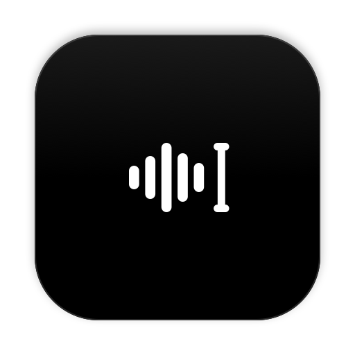

<p align="center"></p>

# VoiceFlow

Voice typing for macOS and Windows. Hold a key, speak, let go: polished text appears wherever your cursor
is, in any app.

VoiceFlow removes filler words, applies your spoken corrections, punctuates, formats lists, matches the
tone of the app you're in, and learns the names you use. It is free and open source. You bring your
own [Groq](https://console.groq.com) API key; Groq's free tier covers normal daily use.

> VoiceFlow is an independent project. It is not affiliated with, endorsed by, or connected to
> Wispr Flow or Wispr AI, Inc.

## Features

| | |
|---|---|
| **Dictate anywhere** | Hold **Fn** (Mac) or **Ctrl + Win** (Windows), speak, release. Works in any app with a text field. |
| **Hands-free** | **Fn + Space** or double-tap **Fn**; press **Fn** again to finish. Up to 20 minutes. |
| **Smart cleanup** | Removes "um" and "uh", applies corrections ("Tuesday, no actually Wednesday" → "Wednesday"), punctuates, turns spoken steps into numbered lists, understands "comma", "new line", "new paragraph". |
| **Command Mode** | Select text, hold **Fn + ⌃**, say "make this more formal", "translate to Telugu", "draft a reply saying I'll be late", or "search for…". |
| **Context-aware spelling** | Names visible in the field you're typing in are spelled correctly. |
| **Dictionary** | Add names and jargon, or fix a word the recognizer keeps getting wrong ("Correct a misspelling"). Words you correct after a dictation are learned automatically (with Undo). Import from a file. |
| **Snippets** | Say "my calendar link" and VoiceFlow types the full link. |
| **Style** | Personal messages, Work messages, Email and Other each get Formal, Casual, very casual or Excited!. Code editors and terminals keep code formatting. |
| **Auto Cleanup** | None, Light (default) or Medium, from exactly what you said to rephrased for clarity. |
| **Developer friendly** | Keeps `camelCase` and `snake_case`; in Cursor and Windsurf, spoken file names become `@file` tags. |
| **Whisper mode** | Picks up quiet speech. |
| **40+ languages** | Including Hindi, Tamil and mixed English, or auto-detect. |
| **Telugu** | Speak Telugu or Telugu-English and choose how it's typed: Telugu script, Telugu with English words in English, or Telish in English letters (nenu repu office ki vastanu). With English also selected, VoiceFlow transcribes both ways at once and keeps the right one, because Whisper's auto-detect often mistakes Telugu for Hindi, Tamil or English. |
| **Notetaker** | Takes notes of your calls in Zoom, Meet, Teams, Webex or FaceTime: a live transcript labelled You / Others, then a summary, decisions, action items and open questions. Offers itself when a call starts, and saves each meeting as Markdown to a folder you choose (for example iCloud Drive). |
| **Shortcuts** | **⌃⌘V** pastes your last transcript, **⌃⌘C** copies it, **Esc** cancels. |
| **Flow bar** | A small pill at the bottom of the screen. Click it to start hands-free; right-click to hide it for an hour or switch language. |
| **Home and Insights** | Searchable history grouped by day, words per minute, fixes made, usage by kind of app, and an activity heatmap with streaks. All stored only on your computer. |
| **Scratchpad** | Notes you can dictate into, opened from anywhere with **⌥S**. |

## Download

Get the latest version from [Releases](https://github.com/saideepreddy7781/voiceflow/releases/latest).

| System | File |
|---|---|
| macOS 14 Sonoma or later, Apple silicon or Intel | `VoiceFlow-x.y.z-macOS.dmg` |
| Windows 10 or 11, most PCs | `VoiceFlow-x.y.z-Windows-x64.exe` |
| Windows 11 on Arm (Snapdragon) | `VoiceFlow-x.y.z-Windows-arm64.exe` |

You also need a free Groq API key from [console.groq.com/keys](https://console.groq.com/keys).

### Install on macOS

1. Open the DMG and drag VoiceFlow to Applications.
2. Open VoiceFlow. The builds are not yet signed with an Apple Developer ID, so macOS blocks the first
   launch. Open **System Settings → Privacy & Security**, scroll down, and click **Open Anyway** next to
   VoiceFlow. You only do this once per version.
3. The welcome window walks you through pasting your Groq key (stored in your Keychain) and allowing the
   **Microphone** and **Accessibility** (needed to notice the dictation key and type into other apps).
4. Click into any text field, hold **Fn**, and speak.

Because the app is not Developer ID signed, macOS asks for Microphone and Accessibility again after each update.

### Install on Windows

1. Download the `.exe` for your PC. It is a single portable program; put it anywhere, for example in
   `C:\Users\<you>\Apps\`, and double-click it.
2. The builds are not yet code-signed, so SmartScreen shows "Windows protected your PC". Click
   **More info → Run anyway**. You only do this once per version.
3. Paste your Groq key in the welcome window (stored in Windows Credential Manager). VoiceFlow lives in
   the notification area next to the clock.
4. Click into any text field, hold **Ctrl + Win**, and speak.

Windows shortcuts: **Ctrl + Win + Space** or a double tap for hands-free, **Ctrl + Win + Alt** for Command
Mode, **Alt + Shift + V** to paste the last result, **Esc** to cancel. Settings offer Right Alt or Right Ctrl
instead. Details in [windows/README.md](windows/README.md).

### Check your download

Each release has a `SHA256SUMS.txt` and a build attestation that proves the file was built from this
repository by GitHub Actions:

```bash
shasum -a 256 VoiceFlow-x.y.z-macOS.dmg                      # compare with SHA256SUMS.txt
gh attestation verify VoiceFlow-x.y.z-macOS.dmg -R saideepreddy7781/voiceflow
```

## Privacy

Read [docs/PRIVACY.md](docs/PRIVACY.md) for the full detail. In short:

- **Audio** is sent to Groq for transcription only while you hold the key, in hands-free mode, or while Notetaker records a meeting. VoiceFlow never stores audio.
- **Text sent for cleanup**: your transcript, the app name, up to 120 characters before your cursor, and names found in the field. Command Mode also sends the selected text and the field's text.
- **Never sent or read**: password fields, and apps on the built-in exclusion list (password managers).
- **Stored on your computer only**: history, dictionary, snippets, settings. Your key stays in the macOS Keychain or Windows Credential Manager.
- No accounts, no analytics, no telemetry. The only network destinations are `api.groq.com`, and `perplexity.ai` when you ask Command Mode to search.

## Build from source

**macOS** (Xcode 26, Swift 6.2):

```bash
git clone https://github.com/saideepreddy7781/voiceflow.git
cd voiceflow
swift test --package-path VoiceFlow          # unit tests, no network needed
scripts/build-app.sh release                 # builds build/VoiceFlow.app
open build/VoiceFlow.app
```

**Windows** (.NET 8 SDK; builds on any OS, runs on Windows):

```bash
dotnet test windows/VoiceFlow.Core.Tests
dotnet publish windows/VoiceFlow.Windows -c Release -r win-x64 --self-contained true -p:PublishSingleFile=true
```

Optional live tests against Groq: set `GROQ_API_KEY` and run the same test commands.
Releases are built by GitHub Actions; see [docs/RELEASING.md](docs/RELEASING.md).

## How it works

```
Hotkey (CGEventTap) → microphone (AVAudioEngine, 16 kHz) → Groq Whisper (segments uploaded while you talk)
   → cleanup LLM on Groq (style, names, corrections) → insert via Accessibility, or paste with clipboard restore
```

| Folder | Contents |
|---|---|
| `VoiceFlow/Sources/VoiceFlowCore` | macOS: hotkey gestures, audio, Groq clients, prompts, context reading, insertion, dictionary/snippets/history. Unit tested. |
| `VoiceFlow/Sources/VoiceFlow` | macOS: the menu-bar app, Flow bar, Hub window, onboarding. |
| `VoiceFlow/Tests` | macOS unit tests, plus live tests that run when `GROQ_API_KEY` is set. |
| `windows/` | Windows: `VoiceFlow.Core` (shared logic, runs on any OS), its tests, and the `VoiceFlow.Windows` tray app. |
| `fixtures/` | Cleanup test cases and clip definitions (`scripts/make_fixtures.py` generates the audio). |
| `scripts/` | Build, release, and prompt/transcription evaluation scripts. |
| `docs/` | Privacy, security, releasing, cross-platform plan. |

## Platforms

| Feature | macOS | Windows |
|---|---|---|
| Dictation, hands-free, cleanup, styles, Telugu, 40+ languages | Yes | Yes |
| Command Mode, dictionary, snippets, history | Yes | Yes |
| Notetaker (manual start) | Yes | Yes |
| Notetaker offers itself when a call starts, calendar titles | Yes | Not yet |
| Scratchpad, Insights, auto-learning from your edits, `@file` tags | Yes | Not yet |

Both apps use the same prompts; CI fails if they drift apart (`scripts/check_prompt_parity.py`).
The Windows app is new in 0.1.0 and has been tested by automated checks on Windows runners, not yet by
many people on real PCs. Please [report problems](https://github.com/saideepreddy7781/voiceflow/issues/new).

## Security

Report vulnerabilities privately as described in [SECURITY.md](SECURITY.md). The current security
review and its status are in [docs/SECURITY-REVIEW.md](docs/SECURITY-REVIEW.md).

## License

[MIT](LICENSE)
