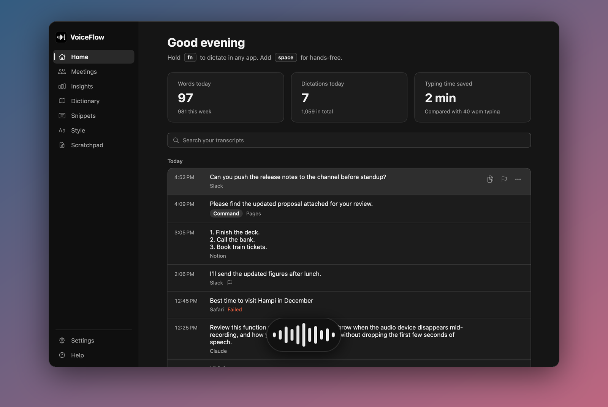
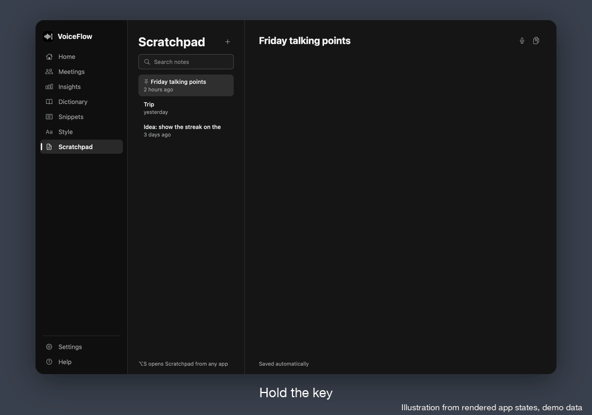
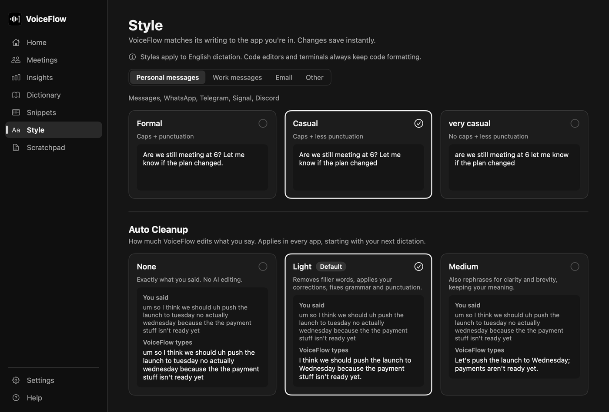
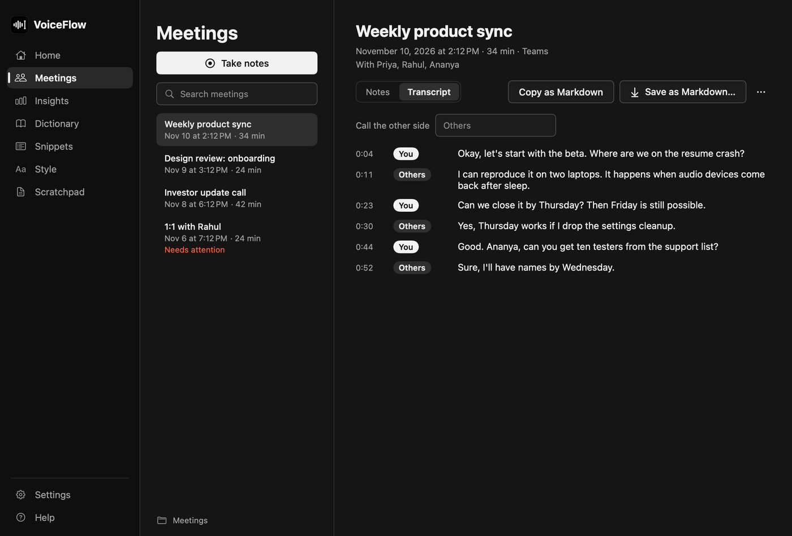
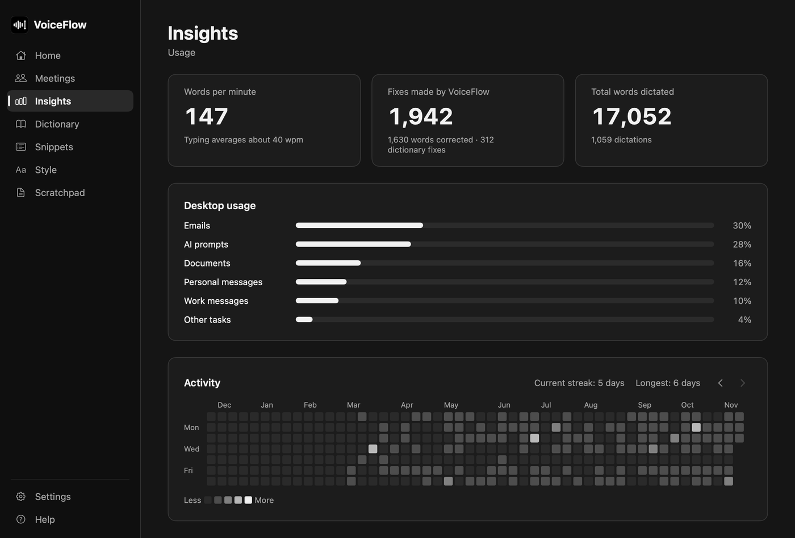
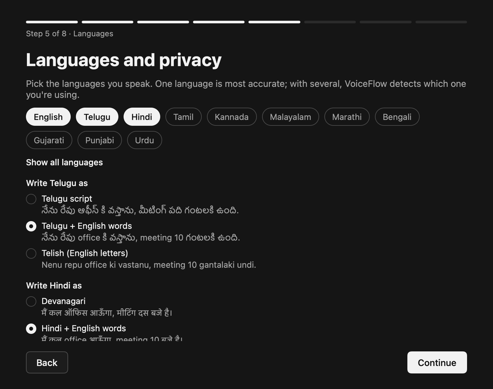
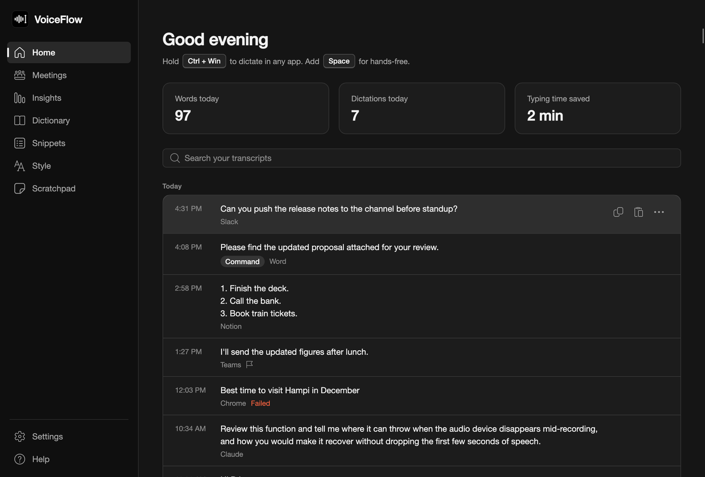
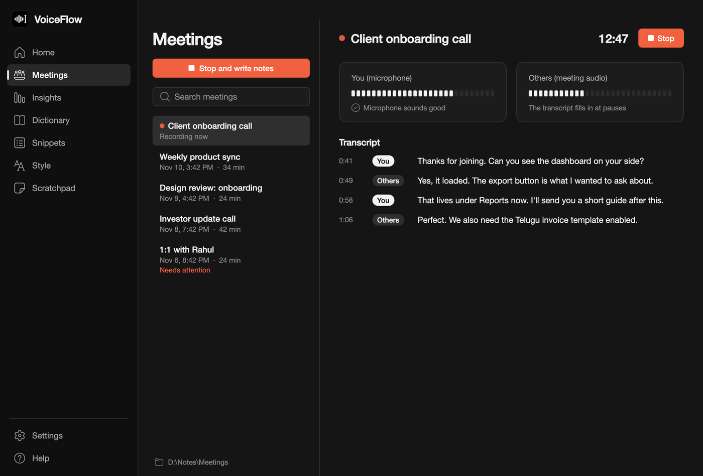
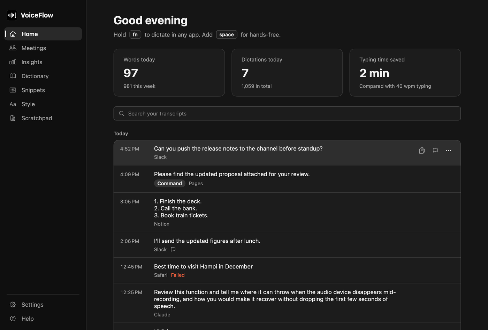
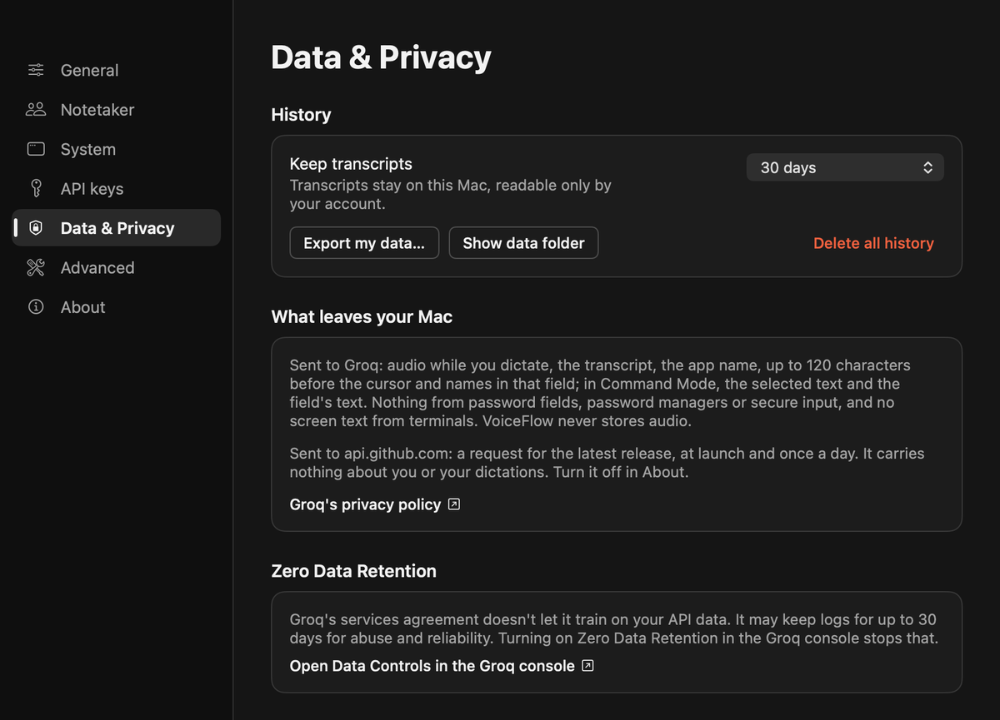

<p align="center"></p>

<h1 align="center">VoiceFlow</h1>

<p align="center">Hold a key, speak, let go. Clean text appears where your cursor is, on macOS and Windows.</p>

<p align="center">
  <a href="https://github.com/saideepreddy7781/voiceflow/releases/latest"></a>
  <a href="https://github.com/saideepreddy7781/voiceflow/actions/workflows/ci.yml"></a>
  <a href="LICENSE"></a>
  
  <a href="https://github.com/saideepreddy7781/voiceflow/stargazers"></a>
</p>



VoiceFlow is free and open source under the MIT license. You use your own free [Groq](https://console.groq.com/keys) API key, and there is no account to create and no server of ours in the path. It removes filler words, applies the corrections you say out loud, and matches the tone of the app you're in.

Two things to know first. Dictation needs an internet connection and a Groq key, because your audio is sent to Groq for transcription. And the builds aren't notarized by Apple or code-signed for Windows, so the first launch takes one extra click.

> VoiceFlow is an independent project. It is not affiliated with, endorsed by, or connected to Wispr Flow or Wispr AI, Inc.

## Screenshots

<p align="center"></p>

<p align="center"><sub>Illustration made from rendered frames of the real app with demo data. This isn't a recording of a live dictation.</sub></p>

<table>
  <tr>
    <td width="50%"><br><sub>Choose a writing style and how much cleanup you want (macOS)</sub></td>
    <td width="50%"><br><sub>Meeting transcripts with real You and Others labels (macOS)</sub></td>
  </tr>
  <tr>
    <td><br><sub>Insights, stored only on your computer (macOS)</sub></td>
    <td><br><sub>Telugu and Hindi writing choices (macOS)</sub></td>
  </tr>
  <tr>
    <td><br><sub>Home on Windows</sub></td>
    <td><br><sub>A live meeting on Windows</sub></td>
  </tr>
  <tr>
    <td><br><sub>Searchable history on a Mac</sub></td>
    <td><br><sub>Settings list what leaves your computer (macOS)</sub></td>
  </tr>
</table>

All of these are rendered from the real app with demo data.

## What you can do

### Write by voice in any app

Hold the hotkey, speak and release, and the text lands in the focused field. Press a second key or double-tap to go hands-free for up to 20 minutes. The Flow bar sits at the bottom of the screen while you dictate, and Settings can keep a resting bar on screen as well. If VoiceFlow can't type into a field, your words stay on the clipboard and in Paste last.

| | macOS | Windows |
|---|---|---|
| Dictate | Hold `Fn` | Hold `Ctrl + Win` |
| Hands-free | `Fn + Space`, or double-tap `Fn` | `Ctrl + Win + Space`, or double-tap |
| Command Mode | Hold `Fn + Control` | Hold `Ctrl + Win + Alt` |
| Cancel | `Esc` | `Esc` |
| Paste last result | `Control + Command + V` | `Alt + Shift + V` |
| Open Scratchpad | `Option + S` | `Alt + Shift + S` |

Settings offer Right Option or Right Command on a Mac, and Right Alt or Right Ctrl on Windows. To copy the last result, press `Control + Command + C` on a Mac or use the tray menu on Windows.

### Get clean text without editing it afterwards

- Filler words go, and spoken corrections are applied: "Tuesday, no actually Wednesday" becomes "Wednesday".
- Punctuation is added, spoken steps become numbered lists, and "comma" and "new paragraph" work as commands.
- Auto Cleanup has three levels. None types exactly what you said, Light is the default, and Medium also rephrases for clarity.
- Whisper mode boosts quiet speech before it is transcribed.

### Match how you write in each app

Personal messages, Work messages, Email and Other each have their own style: Formal, Casual, very casual or Excited!. Styles apply to English dictation. Code editors and terminals always keep code formatting.

### Keep names and phrases right

- Add names and jargon to your dictionary, or tell it to correct a word the recognizer keeps getting wrong.
- If you fix a dictated word soon afterwards and it looks like a name or term, VoiceFlow learns it and shows an Undo.
- Snippets expand a spoken cue into saved text, such as "my calendar link".
- Names visible in the field you're typing in go along with the request, so they come out spelled correctly.

### Edit and draft by voice

Select text, hold the Command Mode keys, and say what you want: "make this more formal", "translate to Telugu", "draft a reply saying I'll be late". "Search for..." opens the search in your browser.

### Take notes of meetings

Notetaker records only after you start it, and a chip with a timer stays on screen the whole time. Your microphone and the call are transcribed separately, so the You and Others labels are real. After the call you get a summary, decisions, action items and open questions. Each meeting can be saved as Markdown to a folder you choose.

VoiceFlow offers to take notes when it sees a call in Zoom, Teams, Google Meet or Webex, plus FaceTime on a Mac, and it only asks. Recording other people can require their consent where you live, so tell everyone on the call. The app reminds you each time unless you turn that off.

### Work in code

`camelCase` and `snake_case` survive cleanup. In Cursor and Windsurf, spoken file names from the open project become `@file` tags. In terminals, line breaks are removed so dictated text can never run a command.

### See your own numbers

Home is a searchable history grouped by day. Insights shows words per minute, fixes made, usage by kind of app and an activity heatmap. Scratchpad is a set of notes you can dictate into. All of it stays on your computer.

### What differs by platform

Windows has the features above too. Calendar titles for meetings and Settings > Export my data are macOS only. The Windows app has passed automated checks on real Windows x64 and Arm runners. Real-world testing on people's PCs is still early, so please [report what breaks](https://github.com/saideepreddy7781/voiceflow/issues/new/choose).

## Download and install

Get the latest version from [Releases](https://github.com/saideepreddy7781/voiceflow/releases/latest). You also need a free Groq key from [console.groq.com/keys](https://console.groq.com/keys).

| System | File |
|---|---|
| macOS 14 or later, Apple silicon or Intel | `VoiceFlow-x.y.z-macOS.dmg` |
| Windows 10 or 11, most PCs | `VoiceFlow-x.y.z-Windows-x64.exe` |
| Windows 11 on Arm | `VoiceFlow-x.y.z-Windows-arm64.exe` |

### macOS

Open the DMG and drag VoiceFlow to Applications, or use Homebrew:

```bash
brew tap saideepreddy7781/voiceflow https://github.com/saideepreddy7781/voiceflow
brew install --cask saideepreddy7781/voiceflow/voiceflow
```

The welcome window then asks for your Groq key and for Microphone and Accessibility permission. Accessibility is how VoiceFlow notices the dictation key and types into other apps. [docs/packaging/homebrew.md](docs/packaging/homebrew.md) explains why the second command names the tap.

### Windows

Download the `.exe` for your PC. It is a single portable program, so put it anywhere and double-click it. Paste your Groq key in the welcome window. VoiceFlow lives in the notification area next to the clock. See [windows/README.md](windows/README.md) for more.

### First launch of an unsigned build

On macOS, open VoiceFlow once, then go to System Settings > Privacy & Security, scroll down and click Open Anyway. Homebrew installs need this too.

On Windows, SmartScreen says "Windows protected your PC". Click More info, then Run anyway.

You do this once per version. Self-signed macOS releases keep Microphone and Accessibility when you update, and ad hoc builds ask for them again. Each release's notes say how that build was signed.

### Check your download

Every release has a `SHA256SUMS.txt` and a build attestation that ties the file to this repository's GitHub Actions:

```bash
shasum -a 256 -c SHA256SUMS.txt --ignore-missing
gh attestation verify VoiceFlow-x.y.z-macOS.dmg -R saideepreddy7781/voiceflow
```

## Languages

Settings list 40 languages, and auto-detect covers others that Whisper knows. Tell VoiceFlow every language you speak. With one language Whisper is told which it is, and that is the most accurate setup. With several, Whisper detects the language and VoiceFlow checks the result against your list, asking for a second opinion when the text doesn't read as the language it was labelled. That can send the same audio up to three times, which uses more of your Groq quota.

Telugu and Hindi have a writing choice that applies to dictation and to meeting transcripts:

| | Telugu | Hindi |
|---|---|---|
| Native script | నేను రేపు ఆఫీస్ కి వస్తాను | मैं कल ऑफिस आऊँगा |
| Script with English words | నేను రేపు office కి వస్తాను | मैं कल office आऊँगा |
| English letters | Nenu repu office ki vastanu | Main kal office aaunga |

The Telugu and Hindi test sentences mix English words in, the way people actually speak. On 11 generated clips (macOS synthetic voices) measured on 2026-11-10, mean word error rate was 13% for Telugu, 19% for Hindi and 10% for English. The previous pipeline scored 54% and 60% on the same Telugu and Hindi clips. These are generated voices and a small sample, so real speech will score differently, and there are no measured figures for real speakers yet. The method is in [docs/LANGUAGE-PIPELINE.md](docs/LANGUAGE-PIPELINE.md), and you can run it on your own recordings. Reports on how it handles your language are welcome through the issue form.

## Privacy

VoiceFlow has no servers, no accounts and no analytics. [docs/PRIVACY.md](docs/PRIVACY.md) lists everything in full. In short:

- Audio goes to Groq (`api.groq.com`) only while you dictate, or while Notetaker records. VoiceFlow never writes audio to disk.
- Text goes to Groq for cleanup: your transcript, the app's name, up to 120 characters before your cursor, and names found in the field. Command Mode also sends the selected text and the field's text. Notetaker sends the transcript, meeting title and attendee names.
- Password fields, secure input and password managers are never read or typed into. Terminal contents are never sent.
- History, dictionary, snippets, notes and meetings stay on your computer. History is kept for 30 days by default. Your key is in the macOS Keychain or Windows Credential Manager.
- The app asks `api.github.com` at launch and once a day whether a new release exists. You can turn that off in Settings > About. "Search for..." in Command Mode opens Perplexity in your browser.

Groq handles your API data under its own terms, and VoiceFlow can't change those for you. As read on 2026-11-10:

- The [Groq Services Agreement](https://console.groq.com/docs/legal/services-agreement) (section 4.2) says Groq may not use inputs or outputs to train models unless the customer permits it.
- [Groq's data page](https://console.groq.com/docs/your-data) says inference requests aren't retained by default. Groq may log inputs and outputs for up to 30 days when troubleshooting failures or investigating suspected abuse.
- You can stop that logging by turning on Zero Data Retention in [Groq's Data Controls](https://console.groq.com/settings/data-controls). Groq also keeps usage metadata, which doesn't contain your inputs or outputs.

Report security problems privately as described in [SECURITY.md](SECURITY.md). The security review is in [docs/SECURITY-REVIEW.md](docs/SECURITY-REVIEW.md).

## How it compares

Read from each product's own site on 2026-11-10. Prices change, so check before you decide.

| | Cost | Platforms | Worth knowing |
|---|---|---|---|
| VoiceFlow | Free. Uses your own Groq key | macOS, Windows | Open source, needs internet, audio goes to Groq |
| [Wispr Flow](https://wisprflow.ai/pricing) | Free plan with a weekly word limit. Pro is $15 per user per month, or $12 billed annually | Mac, Windows, iOS, Android | Includes a notetaker |
| [Superwhisper](https://superwhisper.com/) | Free tier. Pro is $8.49 a month | Mac, Windows, iOS, Android | Works offline |
| [VoiceInk](https://tryvoiceink.com/) | One-time $25, $39 or $49 | Mac (Apple silicon, macOS 14.4 or later) | Transcribes on your device, [source on GitHub](https://github.com/Beingpax/VoiceInk) |

If you want your audio to stay on your own computer, use VoiceInk or [Handy](https://handy.computer/), which is free and open source. If you want a phone app, VoiceFlow doesn't have one. How much you can dictate depends on Groq's free limits, which [Groq lists](https://console.groq.com/docs/rate-limits) at 7,200 audio seconds an hour and 2,000 transcription requests a day (read 2026-11-10). Your own limits are in your Groq console.

## Build from source

macOS needs Xcode 26 and Swift 6.2:

```bash
git clone https://github.com/saideepreddy7781/voiceflow.git
cd voiceflow
swift test --package-path VoiceFlow
scripts/build-app.sh release
open build/VoiceFlow.app
```

Windows needs the .NET 8 SDK. It builds on any OS and runs on Windows:

```bash
dotnet test windows/VoiceFlow.Core.Tests
dotnet test windows/VoiceFlow.Desktop.Tests
dotnet publish windows/VoiceFlow.Windows -c Release -r win-x64 --self-contained true -p:PublishSingleFile=true -p:IncludeNativeLibrariesForSelfExtract=true -p:EnableCompressionInSingleFile=true
```

Live tests against Groq run when `GROQ_API_KEY` is set. Releases are built by GitHub Actions, as described in [docs/RELEASING.md](docs/RELEASING.md).

## Contributing

Bug reports, language quality reports and pull requests are all welcome. Start with [CONTRIBUTING.md](CONTRIBUTING.md) and the [architecture guide](docs/ARCHITECTURE.md). The two apps use identical prompts, and CI checks that they stay identical.

## Roadmap

Next up are real-world testing on Windows PCs, automatic updates and stronger checks before Command Mode rewrites a whole field. See [ROADMAP.md](ROADMAP.md).

## License

[MIT](LICENSE). VoiceFlow is independent and not affiliated with Wispr.
