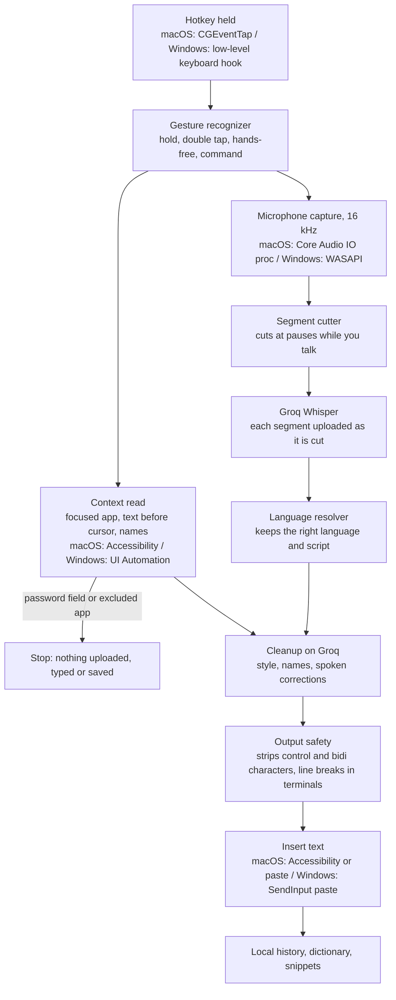

# Architecture

VoiceFlow is two native apps that behave the same way. Each one has a shared-logic library with unit tests
and a thin app layer that talks to the operating system.

| | macOS | Windows |
|---|---|---|
| Language | Swift 6.2 | C# on .NET 8 |
| Logic library (no OS UI) | `VoiceFlow/Sources/VoiceFlowCore` | `windows/VoiceFlow.Core` (`net8.0`, runs on any OS) |
| App layer | `VoiceFlow/Sources/VoiceFlow` | `windows/VoiceFlow.Windows` |
| Tests | `VoiceFlow/Tests` | `windows/VoiceFlow.Core.Tests` |

## The dictation pipeline

If any step fails, the fallback chain keeps your words: cleaned text, then the raw transcript, then the
clipboard with a message in the Flow bar. Text is typed only if the app in front is the one the dictation
started in, and the focused field is checked again for a password field right before typing.

Command Mode follows the same path up to transcription. The spoken instruction, the selected text and the
field's text then go to the command prompt, and the result replaces the selection.

## Notetaker

Notetaker records only after you start it. It keeps your microphone and system audio (macOS Core Audio
process tap, Windows WASAPI loopback) as separate streams, so You and Others are real labels. Only voiced audio
goes to Groq, through a rate-aware queue that gives dictation priority. The two sides are merged into one
time-ordered transcript, echo from speakers is removed, and the summary is written with the notes prompt. Audio
is never written to disk. [LANGUAGE-PIPELINE.md](LANGUAGE-PIPELINE.md) has the details.

### One microphone for dictation and meetings (macOS)

`SharedMicrophone` owns the microphone; dictation and Notetaker subscribe to it, so a dictation during a meeting
shares the meeting's stream. The capture is a Core Audio IO proc on the input device (`LiveMicrophoneEngine`).
It does not use AVAudioEngine: while a call app (Chrome running Google Meet, Zoom, FaceTime) holds the microphone
with Apple's voice processing, an AVAudioEngine input in another app receives exact zeros for the whole call. An
IO proc keeps receiving the microphone. Voice processing also turns the built-in microphone from 1 channel into
a 3-channel array under a running capture, so the IO block takes the channel count from each buffer and reads the
first channel.

The capture rebuilds itself when the device goes away, its sample rate changes, or the default input moves
(AirPods switching to call mode, headphones unplugged). Every other Core Audio notification is ignored.

While a meeting records, `MicHealthMonitor` rebuilds a microphone that sends nothing or exact zeros within 2 to 3
seconds and tells the user within about 6 seconds if that did not help. Meeting audio that has been silent since
the start is reported after 20 seconds, or at once when macOS says the System Audio Recording permission is off.
Notetaker stops by itself a minute after the call app lets go of the microphone and the call audio goes silent,
after a 15-second notice with Keep recording (`CallEndDetector`).

`VoiceFlow --audio-selftest <out.json>` runs these paths on the Mac's real microphone and speakers and writes the
numbers. It plays speech with `say`, uses a local stand-in for transcription, and never touches user data or the
Keychain. Launch it with `open -n VoiceFlow.app --args --audio-selftest <path>` so macOS applies the app's own
microphone permission.

## Where things live

| Part | macOS | Windows |
|---|---|---|
| Gestures | `VoiceFlowCore/Input/GestureRecognizer.swift` | `VoiceFlow.Core/Input/GestureRecognizer.cs` |
| Hotkey hook | `VoiceFlowCore/Input/HotkeyMonitor.swift` | `VoiceFlow.Windows/Input/HotkeyMonitor.cs` |
| Audio capture | `VoiceFlowCore/Audio/SharedMicrophone.swift`, `LiveMicrophoneEngine.swift` | `VoiceFlow.Windows/Audio/AudioCapture.cs` |
| Segmenting | `VoiceFlowCore/Speech/SegmentCutter.swift` | `VoiceFlow.Core/Speech/SegmentCutter.cs` |
| Speech engine | `VoiceFlowCore/Speech/GroqTranscriber.swift` (`Transcriber`) | `VoiceFlow.Core/Speech/GroqTranscriber.cs` (`ITranscriber`) |
| Language handling | `VoiceFlowCore/Speech/LanguageResolver.swift` | `VoiceFlow.Core/Speech/LanguageResolver.cs` |
| Cleanup and prompts | `VoiceFlowCore/AI/` | `VoiceFlow.Core/AI/` |
| Context | `VoiceFlowCore/Context/ContextReader.swift` | `VoiceFlow.Windows/Native/FocusInfo.cs` |
| Output safety | `VoiceFlowCore/Output/OutputSafety.swift` | `VoiceFlow.Core/Output/OutputSafety.cs` |
| Inserting text | `VoiceFlowCore/Output/TextInserter.swift` | `VoiceFlow.Windows/Dictation/TextInserter.cs` |
| Secrets | `VoiceFlowCore/SecretStore.swift` (Keychain) | Windows Credential Manager, in `VoiceFlow.Windows/Native` |
| Controller | `VoiceFlow/DictationController.swift` | `VoiceFlow.Windows/Dictation/DictationController.cs` |

## Rules that hold on both platforms

The prompt text is identical on both platforms and CI checks it with `scripts/check_prompt_parity.py`. User
data keeps decoding across upgrades, so new fields have defaults. What the user said or typed never goes into
logs or diagnostics. Password fields, secure input and password managers are never read or typed into. The
full list of what goes where is in [PRIVACY.md](PRIVACY.md), and the security reasoning is in
[SECURITY-REVIEW.md](SECURITY-REVIEW.md). [CROSS-PLATFORM.md](CROSS-PLATFORM.md) has the longer per-platform
design notes.
