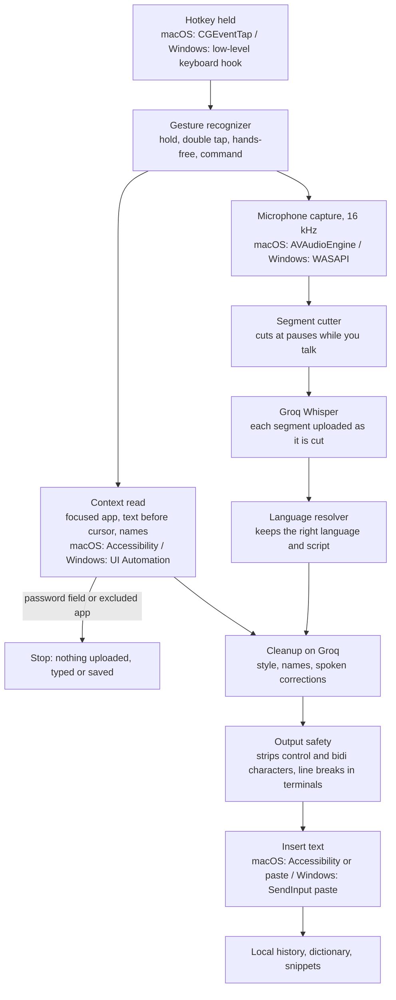

# Architecture

VoiceFlow is two native apps that behave the same way. Each one has a shared-logic library with unit tests
and a thin app layer that talks to the operating system.

| | macOS | Windows |
|---|---|---|
| Language | Swift 6.2 | C# on .NET 8 |
| Logic library (no OS UI) | `VoiceFlow/Sources/VoiceFlowCore` | `windows/VoiceFlow.Core` (`net8.0`, runs on any OS) |
| App layer | `VoiceFlow/Sources/VoiceFlow` | `windows/VoiceFlow.Windows` |
| Tests | `VoiceFlow/Tests` | `windows/VoiceFlow.Core.Tests` |

## The dictation pipeline

If any step fails, the fallback chain keeps your words: cleaned text, then the raw transcript, then the
clipboard with a message in the Flow bar. Text is typed only if the app in front is the one the dictation
started in, and the focused field is checked again for a password field right before typing.

Command Mode follows the same path up to transcription. The spoken instruction, the selected text and the
field's text then go to the command prompt, and the result replaces the selection.

## Notetaker

Notetaker records only after you start it. It mixes your microphone with system audio (macOS Core Audio
process tap, Windows WASAPI loopback) into one stream, uploads pieces of 20 to 45 seconds to Groq, labels
speakers You and Others by comparing the two sources, and writes the summary with the notes prompt. Audio is
never written to disk.

## Where things live

| Part | macOS | Windows |
|---|---|---|
| Gestures | `VoiceFlowCore/Input/GestureRecognizer.swift` | `VoiceFlow.Core/Input/GestureRecognizer.cs` |
| Hotkey hook | `VoiceFlowCore/Input/HotkeyMonitor.swift` | `VoiceFlow.Windows/Input/HotkeyMonitor.cs` |
| Audio capture | `VoiceFlowCore/Audio/AudioRecorder.swift` | `VoiceFlow.Windows/Audio/AudioCapture.cs` |
| Segmenting | `VoiceFlowCore/Speech/SegmentCutter.swift` | `VoiceFlow.Core/Speech/SegmentCutter.cs` |
| Speech engine | `VoiceFlowCore/Speech/GroqTranscriber.swift` (`Transcriber`) | `VoiceFlow.Core/Speech/GroqTranscriber.cs` (`ITranscriber`) |
| Language handling | `VoiceFlowCore/Speech/LanguageResolver.swift` | `VoiceFlow.Core/Speech/LanguageResolver.cs` |
| Cleanup and prompts | `VoiceFlowCore/AI/` | `VoiceFlow.Core/AI/` |
| Context | `VoiceFlowCore/Context/ContextReader.swift` | `VoiceFlow.Windows/Native/FocusInfo.cs` |
| Output safety | `VoiceFlowCore/Output/OutputSafety.swift` | `VoiceFlow.Core/Output/OutputSafety.cs` |
| Inserting text | `VoiceFlowCore/Output/TextInserter.swift` | `VoiceFlow.Windows/Dictation/TextInserter.cs` |
| Secrets | `VoiceFlowCore/SecretStore.swift` (Keychain) | Windows Credential Manager, in `VoiceFlow.Windows/Native` |
| Controller | `VoiceFlow/DictationController.swift` | `VoiceFlow.Windows/Dictation/DictationController.cs` |

## Rules that hold on both platforms

The prompt text is identical on both platforms and CI checks it with `scripts/check_prompt_parity.py`. User
data keeps decoding across upgrades, so new fields have defaults. What the user said or typed never goes into
logs or diagnostics. Password fields, secure input and password managers are never read or typed into. The
full list of what goes where is in [PRIVACY.md](PRIVACY.md), and the security reasoning is in
[SECURITY-REVIEW.md](SECURITY-REVIEW.md). [CROSS-PLATFORM.md](CROSS-PLATFORM.md) has the longer per-platform
design notes.
